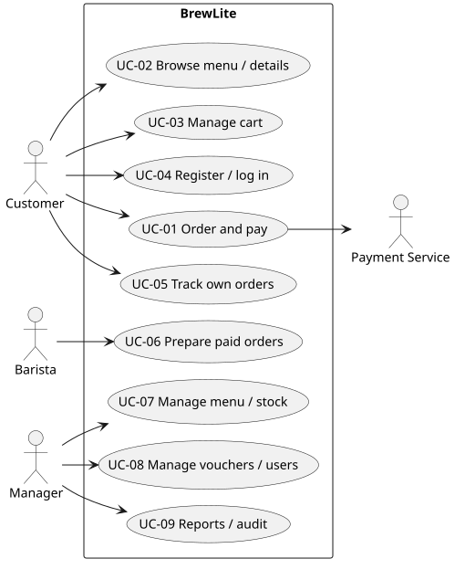
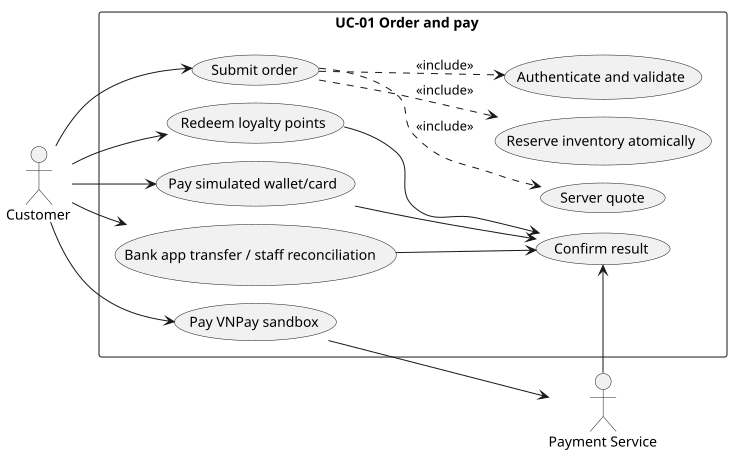
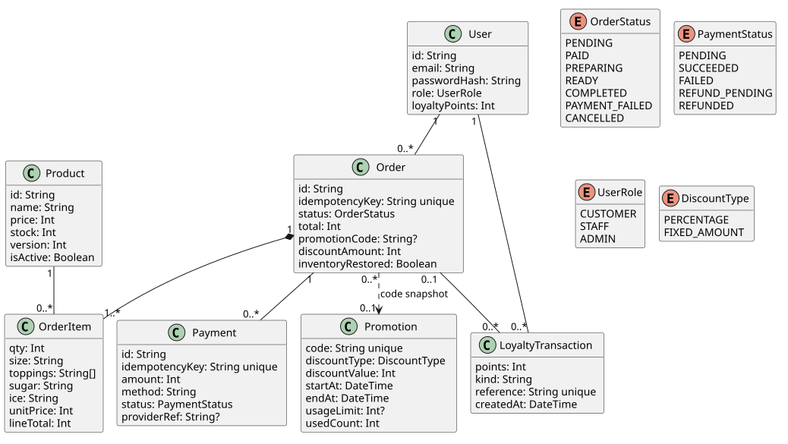
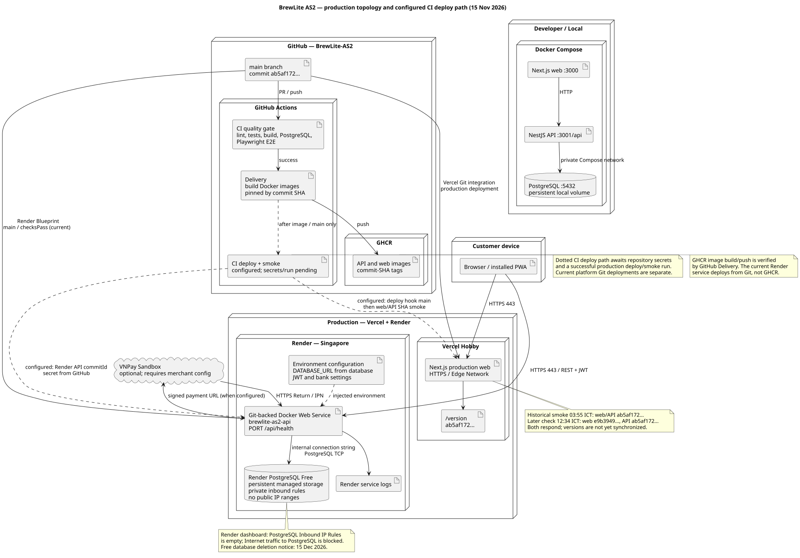

# BÁO CÁO ĐỒ ÁN CÔNG NGHỆ PHẦN MỀM

## BREWLITE — HỆ THỐNG ĐẶT THỨC UỐNG TRỰC TUYẾN

**Trường Đại học Sài Gòn — Khoa Công nghệ Thông tin** 
**Assignment 2 — Requirements to Deployment** 
**Học kỳ I — Năm học 2026–2027**

| Họ và tên | Mã số sinh viên |
|---|---|
| Lê Ngọc Hiếu | 3124410095 |
| Nguyễn Tiến Đạt | 3124410060 |

**Giảng viên hướng dẫn:** Từ Lãng Phiêu 
**Ngày nộp sản phẩm:** 16/11/2026 
**Ngày bảo vệ dự kiến:** 18/11/2026 
**Ngày cập nhật báo cáo:** 15/11/2026 
**Mã nguồn đối chiếu:** `main`, commit `55c02e4` 
**Phiên bản hồ sơ bàn giao:** v0.2.2

---

## Tóm tắt

BrewLite hỗ trợ khách hàng xem thực đơn, tùy chỉnh đồ uống, quản lý giỏ hàng, đặt đơn và theo dõi quá trình phục vụ. Nhân viên đối soát chuyển khoản và cập nhật tiến độ pha chế; quản lý vận hành thực đơn, tài khoản, ưu đãi và kho nguyên liệu. Hệ thống sử dụng Next.js theo hướng mobile-first/PWA, NestJS cho REST API và PostgreSQL/Prisma cho dữ liệu.

Báo cáo trình bày chuỗi yêu cầu → mô hình hóa → thiết kế kiến trúc → triển khai → kiểm thử và bàn giao theo năm task của Assignment 2. Các quyết định trọng tâm gồm tính giá trên server, transaction đặt đơn và giữ tồn, khóa idempotency, kiểm soát cập nhật đồng thời và phân quyền theo dữ liệu tài khoản trong database.

Bản main được đối chiếu hiện cung cấp **chuyển khoản ngân hàng qua VietQR** và **thanh toán bằng điểm tích lũy**. Ví/Thẻ mô phỏng và VNPay đã được bỏ khỏi luồng đang hoạt động sau khi hợp nhất thay đổi thanh toán. Đây là khác biệt so với yêu cầu Ví/Thẻ mô phỏng trong PDF AS2; báo cáo phân biệt rõ yêu cầu gốc, chức năng hiện tại và minh chứng của phiên bản cũ.

Website và API được triển khai trên Vercel/Render. [Delivery run 43710893938](https://github.com/https-monstiez/BrewLite-AS2/actions/runs/43710893938) đã hoàn tất quality gate, đóng gói, deploy và smoke test trên commit `55c02e4`. Video mới ghi thao tác thật trên production tới bước chờ đối soát và lịch sử đơn, không chuyển tiền hoặc xác nhận đã nhận tiền. Hồ sơ Sprint Review/Retrospective hiện là dự thảo chuẩn bị trao đổi, chưa phải biên bản cuộc họp đã xác nhận.

**Từ khóa:** đặc tả yêu cầu, UML, Next.js, NestJS, PostgreSQL, tính toàn vẹn dữ liệu, CI/CD.

## Mục lục

1. [Tổng quan bài toán và phạm vi](#1-tổng-quan-bài-toán-và-phạm-vi)
2. [Task 1 — Khai thác và đặc tả yêu cầu](#2-task-1--khai-thác-và-đặc-tả-yêu-cầu)
3. [Task 2 — Mô hình hóa hệ thống](#3-task-2--mô-hình-hóa-hệ-thống)
4. [Task 3 — Thiết kế kiến trúc](#4-task-3--thiết-kế-kiến-trúc)
5. [Task 4 — Nền tảng Sprint 1 và CI](#5-task-4--nền-tảng-sprint-1-và-ci)
6. [Task 5 — Tích hợp, triển khai và bàn giao](#6-task-5--tích-hợp-triển-khai-và-bàn-giao)
7. [Truy vết và đánh giá mức đáp ứng](#7-truy-vết-và-đánh-giá-mức-đáp-ứng)
8. [Kết luận và hướng phát triển](#8-kết-luận-và-hướng-phát-triển)
9. [Tài liệu tham khảo](#9-tài-liệu-tham-khảo)

## 1. Tổng quan bài toán và phạm vi

### 1.1 Vấn đề nghiệp vụ

Khi cửa hàng ghi nhận đơn thủ công, tùy chọn đồ uống, tổng tiền, tồn kho và tình trạng thanh toán có thể bị cập nhật không thống nhất. Khách khó theo dõi tiến độ, còn nhân viên phải đối chiếu thông tin ở nhiều nơi. BrewLite tập trung dữ liệu đơn và tách trách nhiệm: khách chọn món; server kiểm tra giá, tồn và quyền; nhân viên xác minh khoản chuyển; quản lý vận hành cấu hình cửa hàng.

Luồng nghiệp vụ chính là **xem menu → tùy chọn món → giỏ hàng → đăng nhập → báo giá/đặt đơn → chọn phương thức thanh toán → theo dõi đơn → phục vụ**. Đơn chuyển khoản chưa được xác nhận vẫn ở trạng thái `PENDING`; chỉ đơn `PAID` mới được chuyển sang pha chế.

### 1.2 Phạm vi hiện tại

| Nhóm | Nội dung |
|---|---|
| Chức năng cốt lõi | Menu/chi tiết, size/topping/đường/đá, giỏ qua reload, đăng ký/đăng nhập, báo giá, tạo đơn, chuyển khoản/điểm, xác nhận và lịch sử |
| Chức năng mở rộng | Voucher, loyalty ledger, quản lý menu/tài khoản, audit, nguyên liệu/công thức và nhập kho |
| Không cung cấp trong bản hiện tại | Ví/Thẻ mô phỏng, VNPay/MoMo đang hoạt động, giao hàng, tự động đối soát ngân hàng |
| Giới hạn xác minh | Chưa có giao dịch chuyển tiền thật được kiểm chứng; chưa diễn tập rollback production; chưa kiểm chứng hai DB role riêng trên Render |

Bản cập nhật giữ dữ liệu và các trạng thái cũ để đọc lịch sử đơn. Việc còn mã xử lý hoặc enum cũ trong repository không đồng nghĩa endpoint thanh toán đó đang hoạt động. [Thay đổi phạm vi thanh toán](changes/payment-methods.md) ghi lại quyết định hợp nhất nhánh và ảnh hưởng tới yêu cầu AS2.

### 1.3 Tổ chức tạo phẩm

Tài liệu yêu cầu được lưu trong `docs/requirements`; sơ đồ có nguồn PlantUML và SVG trong `docs/diagrams`; quyết định kiến trúc nằm trong `docs/architecture/adr`. Code được tổ chức ở `apps/web` và `apps/api`; migration/seed thuộc `apps/api/prisma`. Báo cáo liên kết tới các tạo phẩm để có thể đối chiếu thiết kế với hiện thực và kiểm thử.

## 2. Task 1 — Khai thác và đặc tả yêu cầu

### 2.1 Stakeholder

| Stakeholder | Nhu cầu và kỳ vọng |
|---|---|
| Khách hàng | Biết món đang bán, tùy chỉnh hợp lệ, biết tổng tiền và theo dõi đơn của mình |
| Nhân viên quầy | Đối soát đúng khoản chuyển, chỉ pha chế đơn đã thanh toán, cập nhật tiến độ |
| Quản lý | Quản lý thực đơn, ưu đãi, tài khoản, kho và truy vết hoạt động |
| Nhóm phát triển | Quản lý phiên bản, kiểm thử, tái lập môi trường và khôi phục khi có lỗi |
| Giảng viên/người nghiệm thu | Đối chiếu được yêu cầu, sơ đồ, code, kiểm thử và hệ thống chạy thực tế |
| Ngân hàng/dịch vụ QR | Cung cấp ứng dụng chuyển khoản hoặc ảnh QR; BrewLite không mặc nhiên nhận được xác nhận giao dịch từ các bên này |

Ràng buộc chính là công nghệ Next.js/NestJS/PostgreSQL, thời gian nộp đồ án và hạ tầng miễn phí. Backend Free có cold start; database có thời hạn dịch vụ. Các giả định và rủi ro ban đầu được lưu trong [context-and-scope.md](requirements/context-and-scope.md).

### 2.2 Yêu cầu chức năng và mức ưu tiên

[SRS](requirements/srs.md) lưu mã yêu cầu, MoSCoW và tiêu chí chấp nhận gốc. Bảng dưới bổ sung trạng thái bản main đang đối chiếu; không thay đổi tiêu chí gốc để hợp thức hóa thay đổi sản phẩm.

| Mã | Yêu cầu gốc | Ưu tiên | Đối chiếu bản hiện tại |
|---|---|---|---|
| FR-01–03 | Menu, chi tiết/tùy chọn, giỏ hàng | Must | Đã hiện thực; giỏ được lưu qua reload |
| FR-04 | Xác thực và phân quyền | Must | JWT, hash mật khẩu, kiểm tra role từ DB |
| FR-05 | Báo giá và tạo đơn | Must | Server tính giá; transaction, idempotency và kiểm tồn |
| FR-06 | Ví/Thẻ mô phỏng | Must theo PDF | Có ở v0.2.1, **đã bỏ khỏi main hiện tại**; chưa đáp ứng tiêu chí này ở bản mới |
| FR-07–08 | Lịch sử, theo dõi và xử lý đơn | Must | Quyền sở hữu đơn; kiểm soát thứ tự trạng thái |
| FR-09–11 | Menu/tồn, voucher, loyalty | Should | Có module quản trị, kiểm ưu đãi và ledger |
| FR-12 | VNPay sandbox | Should | Không còn được nối vào luồng hoạt động của bản hiện tại |
| FR-13–14 | Quản trị/audit, nguyên liệu/công thức | Should/Could | Có hiện thực và kiểm thử quyền/biến động kho |
| FR-16 | VietQR và đối soát | Bổ sung theo phạm vi nhóm | Chỉ chủ đơn xem chỉ dẫn; STAFF/ADMIN xác nhận sau đối soát |

Ví dụ tiêu chí chấp nhận: cùng idempotency key và cùng nội dung phải trả cùng đơn; thay nội dung với cùng key bị từ chối; khách không đọc đơn người khác; quét QR không tự chuyển `PENDING` thành `PAID`; số dư điểm không đủ phải bị từ chối mà không tạo thanh toán thành công.

### 2.3 Yêu cầu phi chức năng

Các yêu cầu chính gồm bảo mật JWT/RBAC và validation; mobile-first/PWA; triển khai tái lập bằng Docker/migration; transaction và kiểm soát đồng thời; CI và health check sau deploy. Mục tiêu hiệu năng menu được đo trên môi trường test riêng, không được diễn giải thành SLA cloud.

NFR-06 yêu cầu CI lỗi thì không được merge. Repo có required check, nhưng theo lựa chọn quản trị mới, admin được bypass để push trực tiếp vào main. Vì vậy cấu hình hiện tại không cưỡng chế tiêu chí này đối với admin, dù pipeline deploy vẫn phụ thuộc quality gate. Đây là khác biệt cần được tính khi đánh giá mức đáp ứng.

### 2.4 Use-case toàn hệ thống

**Hình 1. Use-case tổng quát của bản hiện tại.** [Nguồn PlantUML](diagrams/use-cases.puml).

Customer thực hiện menu, giỏ, xác thực, đặt/thanh toán và theo dõi đơn. STAFF đối soát và phục vụ đơn đã trả; ADMIN thực hiện nghiệp vụ quản trị và có quyền đối soát. Ứng dụng ngân hàng là môi trường chuyển tiền bên ngoài; liên kết với ngân hàng trong sơ đồ không biểu thị một API callback tự động đã được tích hợp.

### 2.5 UC-01 — Đặt và thanh toán đơn hàng

| Thành phần đặc tả | Nội dung |
|---|---|
| Actor chính | Customer |
| Actor hỗ trợ | STAFF/ADMIN khi đối soát; ứng dụng ngân hàng bên ngoài |
| Trigger | Khách xác nhận giỏ và chọn phương thức thanh toán |
| Tiền điều kiện | Giỏ có món, tùy chọn hợp lệ, khách đăng nhập khi gửi quote/order |
| Thành công | Server lưu tổng tiền và giao dịch; điểm/tồn cập nhật đúng một lần; đơn thành PAID sau khi có căn cứ hợp lệ |
| Chưa hoàn thành | Chuyển khoản giữ PENDING khi chưa đối soát; thiếu điểm từ chối payment, đơn vẫn PENDING |
| Hủy đơn pending | Khách gửi lý do; hệ thống hủy và hoàn lượng giữ tồn một lần |

**Luồng chính:**

1. Khách xem món, chọn size, topping, đường/đá và thêm giỏ.
2. UI gửi quote; API xác thực JWT/DTO, đọc giá, ưu đãi và tồn hiện tại.
3. Khách gửi tạo đơn với `Idempotency-Key`; transaction kiểm tra, giữ tồn và tạo đơn `PENDING`.
4. API tạo giao dịch theo phương thức được hỗ trợ và idempotency key riêng.
5. Với chuyển khoản, API trả VietQR với số tiền/reference từ DB; khách dùng ứng dụng ngân hàng, nhân viên kiểm tra tiền đã nhận rồi xác nhận.
6. Với điểm, transaction kiểm số dư, trừ điểm và ghi ledger/đơn/thanh toán theo quy tắc nghiệp vụ.
7. UI đọc lại đơn từ API. STAFF xử lý `PAID → PREPARING → READY → COMPLETED`.

**Ngoại lệ:** chưa đăng nhập yêu cầu đăng nhập; hết hàng/DTO sai/voucher sai bị từ chối; tranh chấp cập nhật được kiểm tra và retry có giới hạn; key lặp khác payload trả xung đột; thiếu điểm không đánh dấu đã trả; yêu cầu xác nhận chuyển khoản lặp chỉ có một lần được claim thành công. Khi khách hủy đơn đang chờ, tồn được hoàn đúng một lần. Từ chối thanh toán điểm không tự động đồng nghĩa đơn đã được hủy hoặc hoàn tồn.

**Hình 2. Phạm vi use-case đặt và thanh toán.** [Nguồn PlantUML](diagrams/checkout-use-case.puml).

## 3. Task 2 — Mô hình hóa hệ thống

### 3.1 Activity diagram

**Hình 3. Luồng hoạt động và các nhánh xử lý.** [Nguồn PlantUML](diagrams/activity-checkout.puml).

Sơ đồ chia trách nhiệm Customer, API, PaymentsService và Staff. Nhánh lỗi bao gồm chưa đăng nhập, hết hàng/validation không hợp lệ, thiếu điểm và chưa xác minh khoản chuyển. Điểm kiểm soát quan trọng là không cho đơn pending vào pha chế. Nhánh hủy đơn thể hiện riêng để tránh hiểu rằng mọi lỗi thanh toán đều tự động hoàn tồn.

### 3.2 Sequence diagram

**Hình 4. Tương tác Customer–Next.js UI–NestJS API–Database–PaymentsService.** [Nguồn PlantUML](diagrams/sequence-checkout.puml).

Các thông điệp chính là quote, tạo đơn với khóa ổn định, tạo payment, đọc chỉ dẫn chuyển khoản hoặc thanh toán điểm, rồi đọc lại trạng thái. Nhánh `alt` phân biệt đơn cũ/yêu cầu mới, xung đột/hết hàng và chuyển khoản/điểm. PaymentsService là thành phần nghiệp vụ nội bộ, không phải cổng ngân hàng đã tự động xác nhận giao dịch.

API kiểm JWT và role trước khi thực hiện nghiệp vụ; transaction giữ tồn/ghi đơn và các cập nhật có điều kiện bảo vệ dữ liệu khi hai yêu cầu đồng thời. Với chuyển khoản, bước xác nhận phải xuất phát từ STAFF/ADMIN sau thao tác đối soát thực tế. Không sử dụng status hoặc tổng tiền từ query string làm căn cứ thanh toán.

### 3.3 Class diagram

**Hình 5. Mô hình domain và quan hệ dữ liệu.** [Nguồn PlantUML](diagrams/class-domain.puml).

Các lớp bắt buộc gồm User, Product, Order, OrderItem, Payment, Promotion và LoyaltyTransaction. User sở hữu nhiều đơn; Order có ít nhất một OrderItem và có thể lưu nhiều lần thử thanh toán; OrderItem chụp lại giá/tùy chọn để lịch sử không đổi khi menu đổi. Unique key/reference và trường version hỗ trợ chống lặp và kiểm soát tranh chấp.

Ingredient, RecipeIngredient, IngredientReservation và StockMovement mở rộng cho định lượng và kho; xem [sơ đồ kho riêng](diagrams/class-inventory.svg). Enum vẫn giữ `PAYMENT_FAILED` cùng các trạng thái cũ để đọc dữ liệu lịch sử; payment mới chỉ chấp nhận `BANK_TRANSFER` hoặc `LOYALTY_POINTS`.

### 3.4 Nhất quán mô hình

| Quy tắc | Mô hình thể hiện | Hiện thực/kiểm chứng |
|---|---|---|
| Giá do server quyết định | Activity kiểm tra, sequence quote, snapshot OrderItem | Quote bỏ qua giá từ client; test chống sửa payload |
| Không bán vượt tồn | Nhánh hết hàng, transaction/cập nhật version | PostgreSQL concurrent integration |
| Không thanh toán lặp | Key payment, claim trạng thái, ledger unique reference | Hai xác nhận đồng thời chỉ một lần thành công |
| Chỉ chủ đơn đọc dữ liệu riêng | Actor Customer, API đọc owned order | Test truy cập chéo tài khoản bị từ chối |
| Chỉ pha đơn đã trả | Lane Staff sau PAID, enum OrderStatus | Test chặn chuyển sai bước và bỏ qua thanh toán |

## 4. Task 3 — Thiết kế kiến trúc

### 4.1 Kiến trúc phân lớp

| Thành phần | Trách nhiệm |
|---|---|
| Next.js/PWA | Menu mobile-first, giỏ, xác thực, checkout, lịch sử và quản trị |
| NestJS controllers/guards | REST API, validate DTO, JWT và RBAC |
| Domain services | Giá/ưu đãi, đơn, điểm, đối soát, tồn và audit |
| Prisma/PostgreSQL | Transaction, ràng buộc unique, lưu dữ liệu, migration/seed |
| Health/configuration/log | Kiểm kết nối DB, cấu hình theo môi trường, ghi hoạt động |

Nhóm chọn modular monolith để phù hợp quy mô hai thành viên và giữ transaction checkout–inventory trong một database. Ưu điểm là ít thành phần vận hành, dễ tái lập và truy vết; hạn chế là các module chưa được scale độc lập. Ghép Vercel và Render giảm chi phí triển khai nhưng cần quản lý CORS, URL build-time và đồng bộ phiên bản hai nền tảng. [Tổng quan và ADR](architecture/overview.md) lưu các đánh đổi cụ thể.

### 4.2 Deployment diagram

**Hình 6. Ranh giới local, CI/registry và production.** [Nguồn PlantUML](diagrams/deployment.puml).

Local chạy Docker Compose gồm web/API/DB; PostgreSQL không publish trực tiếp cổng host. Production dùng Vercel Hobby cho Next.js và Render Free cho Docker API/PostgreSQL. Dashboard đã xác nhận inbound rules DB trống và URL kết nối nội bộ trong Blueprint; giá trị secret không được ghi trong báo cáo.

CI build images tag SHA và push GHCR; Render hiện build Docker từ Git commit được chỉ định qua API, không pull chính GHCR image. Hook Vercel triển khai đầu nhánh main; smoke kiểm phiên bản cả web/API. VietQR cung cấp ảnh QR cho browser; chuyển tiền diễn ra ở ứng dụng ngân hàng bên ngoài. Không có bank receipt callback tự động được cấu hình.

Database Free có thông báo hết hạn/xóa 15/12/2026. Health `SELECT 1` không chứng minh được mọi quyền DB hoặc cấu hình backup. Hai role migrator/app đã có mô hình và kiểm thử local ở phương án VPS; chưa dùng kết quả đó để khẳng định Render đã cấu hình tương tự.

## 5. Task 4 — Nền tảng Sprint 1 và CI

Sprint Goal là tạo nền tảng kỹ thuật, tài liệu có kiểm soát phiên bản và MVP xem menu chạy được. Repository tách riêng AS2, giữ lịch sử nền AS1 và tổ chức `apps/web`, `apps/api`, `docs`, `tests`, workflow, env mẫu và Docker Compose. [Product Backlog/Definition of Done](process/backlog.md) mô tả các nhóm công việc và tiêu chí hoàn thành; đây là backlog tái lập, không phải biên bản lịch sử các cuộc họp.

MVP cung cấp `GET /api/products` và `GET /api/products/:id`; UI có loading/empty/error, dữ liệu seed và test menu/luồng chính. Task 1–3 có file nguồn và kết xuất theo thứ tự commit đã lưu trong repo. Các PR trước đây cung cấp minh chứng CI đạt và CI phát hiện lỗi cấu hình PostgreSQL service health.

CI chạy Install → Lint → Test → Build, sau đó kiểm thử integration/browser theo workflow. Hiện nhóm làm trực tiếp trên main; required check còn được cấu hình nhưng admin có quyền bypass theo yêu cầu vận hành. Pipeline CD vẫn chỉ deploy sau khi job quality thành công. Cần phân biệt gate trước deploy với việc ngăn mọi admin ghi code lên main.

## 6. Task 5 — Tích hợp, triển khai và bàn giao

### 6.1 Chức năng tích hợp

Luồng hiện tại nối tùy chọn món, giỏ, JWT, quote server, transaction tạo đơn, chuyển khoản/điểm và lịch sử/trạng thái. UI mới dùng nút chọn mức đường 0/25/50/75/100%; API cũng nhận 25/75 và vẫn nhận 30/70 từ client cũ. Chỉ giao dịch BANK_TRANSFER được xác nhận thủ công; các phương thức đã bỏ bị từ chối ngay khi validate request.

So với PDF AS2, bản main này chưa đáp ứng Ví/Thẻ mô phỏng của Task 5.1/FR-06. Video mô phỏng cũ và source tag v0.2.1 chứng minh phiên bản trước, không thay thế việc nghiệm thu chức năng đang hoạt động của bản mới. Báo cáo không kết luận toàn bộ Task 5 đã hoàn thành khi còn ngoại lệ chức năng và hồ sơ quy trình.

### 6.2 Kiểm thử

| Loại kiểm thử | Số lượng trong bộ test |
|---|---:|
| Backend unit/HTTP authorization | 84 |
| Frontend Vitest | 7 |
| PostgreSQL integration | 12 |
| Playwright mobile browser | 4 |
| Orchestration CD với HTTP mô phỏng | 16 |
| **Tổng** | **123** |

Bộ integration hiện kiểm chuyển khoản, tranh chấp payment, ledger, hoàn tồn khi hủy pending, quyền truy cập và từ chối phương thức đã bỏ. Nghiệp vụ trừ/nhận điểm còn có kiểm thử unit riêng. Browser kiểm checkout tới pending, xác nhận bằng ADMIN trên API test, QR chờ đối soát, PWA offline và trang quản trị. Tài khoản nhận trong test là dữ liệu giả; không gửi tiền ngân hàng thật. Unit test dùng mock được phân biệt với transaction PostgreSQL thực và deploy production thực. Chi tiết và log nằm trong [testing.md](testing.md).

### 6.3 CI/CD và minh chứng production

[Delivery run 43710893938](https://github.com/https-monstiez/BrewLite-AS2/actions/runs/43710893938) có quality/image/deploy success trên commit `55c02e4a4b4c63f1abd5554c6d22647e968a45b4`. Sau lần triển khai này web và API đã báo đúng commit nguồn được đối chiếu. Đây là snapshot có thời điểm; commit tài liệu tiếp theo có thể làm SHA đang phục vụ thay đổi.

| Tạo phẩm | Đường dẫn/minh chứng |
|---|---|
| Source AS2 | [github.com/https-monstiez/BrewLite-AS2](https://github.com/https-monstiez/BrewLite-AS2) |
| Frontend HTTPS | [brew-lite-as-2.vercel.app](https://brew-lite-as-2.vercel.app/) |
| API menu/health | [GET products](https://brewlite-as2-api.onrender.com/api/products), [GET health](https://brewlite-as2-api.onrender.com/api/health) |
| Version web | [GET /version](https://brew-lite-as-2.vercel.app/version) |
| Video hiện tại | [Checkout chuyển khoản và lịch sử](demo/README.md) |
| Hồ sơ cập nhật | [v0.2.2](https://github.com/https-monstiez/BrewLite-AS2/releases/tag/v0.2.2): PDF, Word và video chuyển khoản thay thế |
| Release trước | [v0.2.1](https://github.com/https-monstiez/BrewLite-AS2/releases/tag/v0.2.1), có phương thức mô phỏng của phiên bản cũ |
| Runbook | [Deploy/rollback](deployment.md), [cấu hình CI deploy](cd-setup.md) |

Pipeline quality → image SHA/GHCR → deploy bằng secrets → migration startup → API health/menu/version → Vercel hook → kiểm web/API SHA. Response Render 202 Queued được xử lý bằng tìm deployment mới đúng SHA, không chấp nhận deployment cũ làm bằng chứng. Lỗi dừng pipeline và dẫn tới runbook rollback.

Rollback dùng source commit tốt trên Render và deployment web tương thích trên Vercel, rồi kiểm lại health/menu/version. Không reset/drop database; migration không tương thích ngược cần fix-forward hoặc kế hoạch phục hồi. Chưa có diễn tập rollback production được ghi nhận.

### 6.4 Video và hướng dẫn bàn giao

Video mobile mới ghi trên production: đăng nhập CUSTOMER demo → chọn size M, đường 25%, đá 50% → giỏ qua reload → tạo đơn chuyển khoản → trạng thái chờ đối soát → lịch sử đơn. Ảnh QR và thông tin tài khoản nhận được che trong bản ghi; API và trạng thái đơn vẫn là dữ liệu thực. Video không thực hiện chuyển tiền, không gọi endpoint xác nhận của nhân viên và không hiển thị đơn đó như đã thanh toán.

README hướng dẫn cài đặt, chạy local/test/build; deployment guide cung cấp URL, cấu hình môi trường và rollback. Ba tài khoản demo đã đăng nhập đúng quyền trong lần kiểm chứng. [Checklist bàn giao](process/handover.md) ghi việc có minh chứng và việc còn cần nhóm thực hiện.

### 6.5 Sprint Review và Sprint Retrospective

Sprint Review đánh giá sản phẩm theo Sprint Goal và tiêu chí chấp nhận; Sprint Retrospective đánh giá cách làm việc và thống nhất cải tiến. [Tài liệu dự thảo](process/sprint-review-retrospective.md) chuẩn bị nội dung từ các lỗi và kết quả có minh chứng. Nhóm cần ghi thời gian, người tham dự, phản hồi và quyết định thực tế; tài liệu dự thảo không được tính là cuộc họp đã diễn ra.

## 7. Truy vết và đánh giá mức đáp ứng

| Yêu cầu/nhóm task | Thiết kế | Hiện thực/kiểm thử | Kết quả đánh giá |
|---|---|---|---|
| FR-01–05 | Use-case, activity, sequence, class | Menu/auth/quote/orders và unit/integration/browser | Có code và minh chứng kiểm thử |
| FR-06 | Phạm vi gốc và thay đổi thanh toán | Ví/Thẻ mô phỏng đã bỏ khỏi main | Chưa đáp ứng bản hiện tại |
| FR-07–08 | State machine, quyền sở hữu | History/queue/transition tests | Có hiện thực và kiểm thử |
| FR-09–14 | Domain/admin/inventory | Menu/voucher/ledger/kho; VNPay không hoạt động | Nhóm mở rộng có phần đã làm, không tính FR-12 là đang bật |
| FR-16 | Nhánh bank, Staff reconciliation | Private instructions, role guard, atomic confirm | Có code/test; chưa xác minh nhận tiền thật |
| Task 2–3 | UML nguồn/SVG, ADR, deployment | Sơ đồ cập nhật theo ngân hàng/điểm | Có tạo phẩm đối chiếu |
| NFR-06 | Workflow và branch policy | CI chạy; admin bypass push main | Chưa cưỡng chế hoàn toàn tiêu chí không merge khi CI lỗi |
| Task 5.3 | CI/deploy topology | Run 43710893938 deploy/smoke success | Có minh chứng pipeline thực |
| Task 5.4 | URL, README, video, process | Source/hosting/video có; Review/Retro dự thảo | Hồ sơ quy trình còn cần xác nhận |

[Ma trận truy vết](traceability-matrix.md) lưu đường dẫn chi tiết; trạng thái được đọc cùng [thay đổi thanh toán](changes/payment-methods.md) để không suy diễn kết quả của phiên bản trước thành chức năng còn được bật.

## 8. Kết luận và hướng phát triển

BrewLite đã xây dựng được hệ thống đặt thức uống có quản lý dữ liệu tập trung, transaction, phân quyền và kiểm thử nhiều tầng. Nhóm có code tái lập, bộ UML, tài liệu kiến trúc, URL production và pipeline CI deploy/smoke được kiểm chứng. Bản cập nhật tập trung chuyển khoản/điểm; video mới minh họa đúng trạng thái chờ xác minh khoản chuyển.

Mức đáp ứng được đánh giá theo tạo phẩm và hành vi thực tế. Các ngoại lệ còn lại là Ví/Thẻ mô phỏng theo yêu cầu PDF đã bị bỏ ở main mới, admin được bypass required checks, và biên bản Sprint chưa được xác nhận. Nếu cần đáp ứng đầy đủ rubric gốc, nhóm phải thống nhất lại các ngoại lệ này trước nghiệm thu; không sử dụng tài liệu để thay thế chức năng hoặc hoạt động chưa có.

Hướng phát triển gồm hoàn thiện hồ sơ Sprint, kiểm thử trên thiết bị vật lý, diễn tập khôi phục, quản lý quyền DB tách biệt và triển khai đối soát/cổng thanh toán tự động khi có merchant, thông tin cấu hình và nhu cầu thực tế. Trước buổi bảo vệ, kiểm tra lại URL, trạng thái API, tài khoản demo, dữ liệu mẫu và khả năng khởi động của hosting Free.

## 9. Tài liệu tham khảo

1. *BrewLite — Assignment 2: Requirements to Deployment*, phiên bản 1.0, Khoa Công nghệ Thông tin, Trường Đại học Sài Gòn, năm học 2026–2027; tài liệu đề bài do nhóm cung cấp.
2. [Repository BrewLite-AS2](https://github.com/https-monstiez/BrewLite-AS2), code đối chiếu commit `55c02e4`.
3. [GitHub Actions Delivery run 43710893938](https://github.com/https-monstiez/BrewLite-AS2/actions/runs/43710893938), commit `55c02e4`, kiểm chứng 15/11/2026.
4. [Release v0.2.1](https://github.com/https-monstiez/BrewLite-AS2/releases/tag/v0.2.1), phiên bản trước thay đổi phạm vi thanh toán.
5. [Tài liệu deployment](deployment.md), [kiểm thử](testing.md), [thay đổi phạm vi](changes/payment-methods.md), [video mới](demo/README.md).
