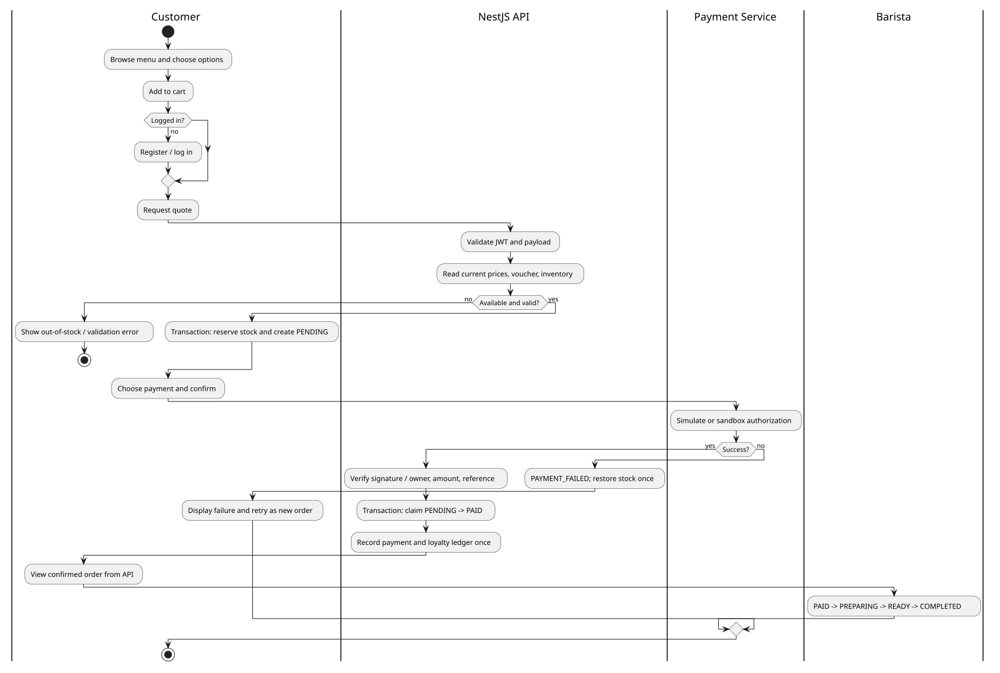
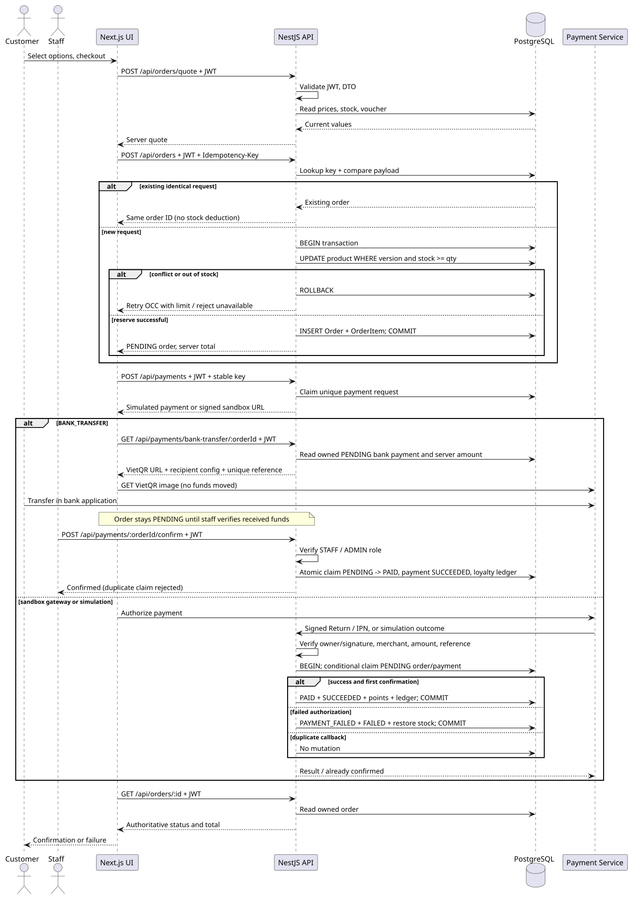

# BÁO CÁO ĐỒ ÁN CÔNG NGHỆ PHẦN MỀM

## BREWLITE — HỆ THỐNG ĐẶT THỨC UỐNG TRỰC TUYẾN

**Assignment 2 — Requirements to Deployment** 
**Trường Đại học Sài Gòn — Khoa Công nghệ Thông tin** 
**Năm học 2026–2027**

> **Nhóm cần hoàn thiện trước khi nộp:** điền thông tin giảng viên và ngày nộp theo yêu cầu; bổ sung link video demo; ghi nhận Sprint Review và Sprint Retrospective thực tế. Các thông tin này không được giả định trong báo cáo.

| Thành viên | MSSV |
|---|---|
| Lê Ngọc Hiếu | 3124410095 |
| Nguyễn Tiến Đạt | 3124410060 |

**Giảng viên hướng dẫn:** [Điền nếu mẫu yêu cầu] 
**Ngày nộp:** [Điền ngày nộp]

---

> **Cập nhật kiểm tra 15/11/2026 khoảng 12:34 ICT:** web đã lên SHA `e9b3949`, API vẫn ở `ab5af17`; cả hai trả 200. Các đoạn ghi cùng SHA dưới đây mô tả lần kiểm tra trước. Task 5.3 còn thiếu run CI deploy/smoke thật; xem [cd-setup.md](cd-setup.md).

## Tóm tắt

BrewLite là hệ thống đặt thức uống trực tuyến. Báo cáo tập trung mô tả cách phân rã yêu cầu thành các luồng nghiệp vụ và cách biểu diễn các luồng đó bằng use-case, activity, sequence, class và deployment diagram theo Assignment 2. Luồng nghiệp vụ trọng tâm là đặt và thanh toán đơn: khách chọn món, hệ thống báo giá từ dữ liệu server, kiểm tra và giữ tồn kho, ghi nhận thanh toán, rồi cho phép nhân viên xử lý đơn đã thanh toán.

Hệ thống dùng Next.js/PWA cho giao diện, NestJS cho REST API và PostgreSQL/Prisma cho dữ liệu. Bên cạnh ví/thẻ mô phỏng, hệ thống có VietQR cần nhân viên đối soát; VNPay chỉ được mô tả là Sandbox khi đã cấu hình merchant. Các sơ đồ trong báo cáo được liên kết với yêu cầu, mô hình dữ liệu và kiểm thử để người đọc có thể lần theo cùng một nghiệp vụ từ yêu cầu đến triển khai.

Tại thời điểm kiểm tra ngày 15/11/2026, website và API production hoạt động tại Vercel/Render, trả cùng SHA `ab5af1728c75be75c6b5c7d150fcd6ed6028d409`; GitHub Release `v0.2.0` đã được tạo. GitHub Actions kiểm tra và đóng gói image lên GHCR; production hiện được triển khai qua Git integration của Render/Vercel, không khẳng định GH Actions đã triển khai image đó.

**Từ khóa:** yêu cầu phần mềm, phân luồng nghiệp vụ, UML, Activity diagram, Sequence diagram, Next.js, NestJS, PostgreSQL, CI/CD.

## Mục lục

1. [Tổng quan và quy trình thực hiện](#1-tổng-quan-và-quy-trình-thực-hiện)
2. [Task 1 — Khai thác và đặc tả yêu cầu](#2-task-1--khai-thác-và-đặc-tả-yêu-cầu)
3. [Task 2 — Phân luồng và mô hình hóa](#3-task-2--phân-luồng-và-mô-hình-hóa)
4. [Task 3 — Thiết kế kiến trúc](#4-task-3--thiết-kế-kiến-trúc)
5. [Task 4 — Sprint 1: MVP xem menu và CI](#5-task-4--sprint-1-mvp-xem-menu-và-ci)
6. [Task 5 — Sprint 2, kiểm thử và bàn giao](#6-task-5--sprint-2-kiểm-thử-và-bàn-giao)
7. [Truy vết yêu cầu](#7-truy-vết-yêu-cầu)
8. [Kết luận và nội dung nhóm cần bổ sung](#8-kết-luận-và-nội-dung-nhóm-cần-bổ-sung)

---

## 1. Tổng quan và quy trình thực hiện

### 1.1 Bài toán

Khi đặt thức uống qua trao đổi thủ công, tùy chọn món, tổng tiền, tình trạng thanh toán và lượng hàng có thể bị ghi nhận không thống nhất. BrewLite số hóa luồng đặt hàng và tách rõ trách nhiệm: khách hàng chọn món, hệ thống xác nhận giá/tồn/thanh toán, nhân viên chỉ xử lý đơn đã trả tiền, còn quản lý chịu trách nhiệm cấu hình menu và nghiệp vụ quản trị.

### 1.2 Luồng nghiệp vụ tổng quát

**Xem menu → chọn tùy chỉnh → giỏ hàng → đăng nhập → báo giá và đặt đơn → thanh toán → theo dõi đơn → nhân viên pha chế và hoàn tất.**

Các nhánh lỗi cần được mô hình hóa thay vì chỉ mô tả đường thành công:

- Chưa đăng nhập: yêu cầu đăng nhập trước khi đặt đơn.
- Món hết hàng hoặc dữ liệu/voucher không hợp lệ: từ chối yêu cầu, không tạo đơn dở dang.
- Thanh toán thất bại: đánh dấu thất bại và hoàn tồn kho đúng một lần.
- Gửi lại cùng yêu cầu: idempotency trả kết quả của đơn/giao dịch cũ, không trừ tồn hoặc ghi nhận điểm lần hai.
- Chuyển khoản: đơn chờ đối soát; khách không tự xác nhận tiền đã nhận.
- Đơn chưa thanh toán: không được đưa vào hàng đợi pha chế.

### 1.3 Quy trình năm task theo đề

| Task | Mục tiêu | Tạo phẩm chính | Trạng thái |
|---|---|---|---|
| 1. Yêu cầu | Xác định stakeholder, phạm vi, yêu cầu và use-case trọng tâm | Context/scope, SRS, use-case, đặc tả UC-01 | Đã có tài liệu trong `docs/requirements` |
| 2. Mô hình hóa | Biểu diễn luồng nghiệp vụ và dữ liệu | Activity, Sequence, Class diagram; nguồn `.puml` và ảnh `.svg` | Đã có trong `docs/diagrams` |
| 3. Kiến trúc | Chọn thành phần, ranh giới và cách triển khai | Tổng quan, ADR, deployment diagram | Đã có; sơ đồ deployment mô tả nền tảng thực tế |
| 4. Sprint 1 | Xây nền tảng và MVP xem menu | Repo, tài liệu, menu/API, CI cơ bản | Đã hiện thực |
| 5. Sprint 2 | Hoàn thiện luồng, kiểm thử và delivery | Checkout, test, CI/Delivery, production, release, bàn giao | Phần lớn đã có; video và biên bản thật nhóm cần bổ sung |

---

## 2. Task 1 — Khai thác và đặc tả yêu cầu

### 2.1 Stakeholder và phạm vi

| Stakeholder | Kỳ vọng |
|---|---|
| Khách hàng | Xem món, tùy chỉnh, biết tổng tiền, thanh toán và theo dõi đơn của mình |
| Nhân viên quầy/barista (STAFF) | Chỉ nhận đơn đã thanh toán; cập nhật trạng thái theo thứ tự |
| Quản lý cửa hàng (ADMIN) | Quản lý món, giá, voucher, tài khoản, kho và hoạt động quản trị |
| Giảng viên/người nghiệm thu | Theo dõi được yêu cầu, sơ đồ, kiểm thử và hệ thống chạy thực tế |
| Nhóm phát triển | Làm việc có kiểm soát phiên bản, kiểm thử và tái lập môi trường |
| Đơn vị thanh toán | Nhận yêu cầu hợp lệ; xác nhận giao dịch đúng số tiền và không lặp |

**Trong MVP:** menu, chi tiết món, tùy chỉnh size/topping/đường/đá, giỏ hàng, xác thực, tạo đơn, thanh toán mô phỏng, xác nhận/lịch sử đơn và hàng đợi nhân viên.

**Mở rộng:** voucher, điểm thành viên, VNPay Sandbox có cấu hình merchant, quản lý kho nguyên liệu và VietQR cần nhân viên đối soát.

**Ngoài phạm vi:** xử lý thanh toán production khi chưa có merchant, giao hàng và tự động xác nhận tiền ngân hàng chỉ dựa vào việc khách quét QR. Chi tiết giả định/ràng buộc được lưu tại [context-and-scope.md](requirements/context-and-scope.md).

### 2.2 Yêu cầu chức năng và phi chức năng

Các yêu cầu chi tiết, mã định danh, mức ưu tiên MoSCoW và tiêu chí nghiệm thu nằm trong [SRS](requirements/srs.md). Nhóm yêu cầu liên quan trực tiếp đến các sơ đồ:

| Mã | Yêu cầu | Liên quan đến luồng/sơ đồ |
|---|---|---|
| FR-01–03 | Xem món, tùy chỉnh và quản lý giỏ | Use-case tổng quát, Activity |
| FR-04 | Đăng nhập và phân quyền | Use-case, Activity, Sequence |
| FR-05 | Báo giá server-side và tạo đơn | UC-01, Activity, Sequence, Class |
| FR-06 | Thanh toán và chống xử lý lặp | UC-01, Sequence, Class |
| FR-07–08 | Lịch sử, theo dõi và xử lý trạng thái | Activity, Sequence, Class |
| FR-09–14 | Quản trị, voucher, loyalty và kho | Use-case tổng quát, Class |
| FR-16 | VietQR và nhân viên đối soát | Activity, Sequence |
| NFR-02/05 | Bảo mật và toàn vẹn dữ liệu | Sequence, Class, deployment |
| NFR-06/07 | CI, delivery và triển khai | Deployment diagram |

NFR chính gồm bảo mật JWT/RBAC và validation, giao diện responsive/PWA, triển khai tái lập bằng Docker, tính toàn vẹn qua transaction/idempotency/OCC, kiểm thử PostgreSQL, pipeline CI và health check sau triển khai. Tiêu chí đo cụ thể được ghi trong SRS; số đo local không được xem là SLA production.

### 2.3 Use-case toàn hệ thống

**Hình 1. Use-case tổng quát.** Nguồn: [use-cases.puml](diagrams/use-cases.puml).

Sơ đồ phân vai theo nghiệp vụ:

- **Customer:** xem menu, thao tác giỏ, đăng nhập, đặt/thanh toán và theo dõi đơn.
- **Barista/STAFF:** xử lý đơn đã thanh toán; đối soát chuyển khoản.
- **Manager/ADMIN:** quản lý menu/tồn, voucher/người dùng và báo cáo/audit.
- **Payment Service:** tham gia nhánh thanh toán mô phỏng hoặc Sandbox.

Ranh giới hệ thống giúp phân biệt hành động người dùng với trách nhiệm nội bộ. Ví dụ, khách gửi yêu cầu thanh toán nhưng server mới là nơi xác nhận trạng thái; khách không có use-case tự chuyển đơn sang “đã thanh toán”.

### 2.4 Đặc tả UC-01 — Đặt và thanh toán đơn hàng

**Actor chính:** Customer. **Actor hỗ trợ:** Payment Service, STAFF khi đối soát chuyển khoản. 
**Kích hoạt:** khách xác nhận giỏ hàng và chọn phương thức thanh toán. 
**Tiền điều kiện:** menu hoạt động; giỏ có ít nhất một món; khách đã đăng nhập; tùy chọn món hợp lệ. 
**Hậu điều kiện thành công:** đơn được ghi nhận với tổng do server tính; tồn/điểm/giao dịch được cập nhật tối đa một lần; đơn chỉ vào hàng đợi nhân viên sau khi thanh toán được xác nhận.
**Hậu điều kiện thất bại:** đơn/giao dịch không ở trạng thái thành công; tồn được hoàn nếu đã giữ trước đó; lỗi được hiển thị rõ.

**Luồng chính:**
1. Khách chọn sản phẩm và tùy chỉnh, thêm vào giỏ.
2. Giao diện gửi danh sách sản phẩm/lựa chọn để lấy báo giá.
3. API xác thực JWT, kiểm tra dữ liệu và đọc giá, voucher, tồn kho hiện tại từ database.
4. Khách gửi yêu cầu tạo đơn kèm `Idempotency-Key`.
5. API transaction kiểm tra khóa, cập nhật tồn có điều kiện và tạo đơn `PENDING`.
6. Khách chọn phương thức; API khởi tạo giao dịch với khóa idempotency riêng.
7. Adapter xử lý mô phỏng, Sandbox đã cấu hình hoặc hướng dẫn chuyển khoản.
8. Khi kết quả hợp lệ, API cập nhật thanh toán/đơn/điểm một lần.
9. Giao diện tải lại trạng thái đơn từ API; STAFF tiếp tục xử lý đơn đã trả.

**Luồng thay thế/ngoại lệ:** chưa đăng nhập thì chuyển qua đăng nhập; hết hàng/OCC xung đột thì rollback và yêu cầu khách cập nhật giỏ; voucher không hợp lệ bị từ chối; cùng khóa nhưng payload khác trả xung đột; thanh toán thất bại hoàn tồn đúng một lần; callback lặp không cộng điểm/trừ tồn thêm; chuyển khoản giữ đơn ở trạng thái chờ đến khi nhân viên đối soát. Luồng chi tiết và các liên kết yêu cầu được lưu trong [SRS](requirements/srs.md) và [traceability matrix](traceability-matrix.md).

**Hình 2. Use-case UC-01.** Nguồn: [checkout-use-case.puml](diagrams/checkout-use-case.puml).

---

## 3. Task 2 — Phân luồng và mô hình hóa

Task 2 là trọng tâm mô hình hóa. Ba sơ đồ Activity, Sequence và Class nhìn cùng một UC-01 ở ba góc khác nhau: **ai làm gì và rẽ nhánh ra sao; các thành phần gọi nhau theo thứ tự nào; dữ liệu nào giữ trạng thái và quan hệ nghiệp vụ**.

### 3.1 Activity diagram — các bước và nhánh quyết định

**Hình 3. Luồng hoạt động end-to-end.** Nguồn: [activity-checkout.puml](diagrams/activity-checkout.puml).

Sơ đồ chia swimlane theo Customer, NestJS API, Payment Service và Barista:

1. **Khởi tạo:** Customer duyệt menu, chọn tùy chọn và thêm vào giỏ. Nếu chưa đăng nhập, luồng đi qua đăng ký/đăng nhập trước khi yêu cầu báo giá.
2. **Kiểm tra trước khi đặt:** API xác thực JWT/payload, lấy giá, voucher và tồn hiện tại từ database. Nhánh không hợp lệ/hết hàng kết thúc bằng thông báo lỗi; không tạo đơn thành công.
3. **Tạo đơn:** nếu dữ liệu hợp lệ, API transaction giữ tồn và tạo đơn `PENDING`.
4. **Rẽ nhánh thanh toán:** chuyển khoản tạo VietQR; người dùng chuyển tiền trong ứng dụng ngân hàng; Barista đối chiếu sao kê. Phương thức khác đi qua mô phỏng hoặc Sandbox đã cấu hình.
5. **Kết quả:** thành công chỉ khi hệ thống xác nhận đúng giao dịch; API cập nhật trạng thái/ledger một lần. Thất bại đánh dấu giao dịch thất bại và hoàn tồn một lần.
6. **Xử lý tại quầy:** Barista chuyển đơn đã thanh toán theo `PAID → PREPARING → READY → COMPLETED`. Đơn `PENDING` không được đưa vào pha chế.

Activity diagram tập trung vào thứ tự nghiệp vụ và kết quả mỗi nhánh; nó không thay thế sequence diagram, nơi thể hiện API/lifeline và thông điệp.

### 3.2 Sequence diagram — trao đổi giữa các thành phần

**Hình 4. Tương tác Customer–UI–API–Database–Payment Service.** Nguồn: [sequence-checkout.puml](diagrams/sequence-checkout.puml).

Sequence diagram làm rõ các request/response chính:

1. UI gọi API quote cùng JWT; API validate JWT/DTO, đọc giá và tồn từ PostgreSQL, rồi trả báo giá. Client không được quyền quyết định giá cuối.
2. UI gửi `POST /api/orders` với `Idempotency-Key`. Nếu khóa đã tồn tại và payload giống nhau, API trả lại đơn cũ; nếu là yêu cầu mới, API mở transaction.
3. API giữ tồn bằng cập nhật có điều kiện theo version và số lượng còn. Xung đột/hết hàng dẫn đến rollback; thành công mới tạo Order/OrderItem và commit.
4. UI khởi tạo payment với khóa riêng. Nhánh `BANK_TRANSFER` trả thông tin VietQR/reference từ server; trạng thái giữ chờ nhân viên xác nhận. Nhánh khác gọi adapter mô phỏng hoặc cổng Sandbox.
5. Với callback, API kiểm tra chữ ký/amount/reference và chỉ claim chuyển trạng thái khi đơn còn phù hợp. Callback trùng không gây thêm mutation; thanh toán lỗi hoàn tồn.
6. UI gọi API đọc đơn; API chỉ trả dữ liệu thuộc quyền khách. Trạng thái hiển thị là dữ liệu API, không lấy từ URL hay local storage làm căn cứ thanh toán.

Những cơ chế transaction, idempotency, kiểm tra điều kiện cập nhật và kiểm soát quyền được thể hiện ở đây vì chúng quyết định tính đúng đắn khi có retry, hai khách tranh món cuối hoặc callback lặp.

### 3.3 Class diagram — mô hình domain và trạng thái

**Hình 5. Các lớp domain, quan hệ và trạng thái chính.** Nguồn: [class-domain.puml](diagrams/class-domain.puml).

Các lớp bắt buộc trong đề được nối thành mô hình nghiệp vụ:

- `User` sở hữu nhiều `Order` và `LoyaltyTransaction`.
- `Order` gồm ít nhất một `OrderItem`, có thể có nhiều `Payment`; đơn lưu tổng tiền và trạng thái để truy vết.
- `OrderItem` giữ snapshot lựa chọn/số lượng/đơn giá để đơn không đổi khi giá menu thay đổi về sau.
- `Product` liên kết với các dòng đơn và có `stock`/`version` cho kiểm soát cập nhật tồn.
- `Promotion` gắn với đơn dưới dạng mã/chiết khấu đã áp dụng; `LoyaltyTransaction` lưu biến động điểm theo reference duy nhất.
- Mở rộng kho gồm `Ingredient`, `RecipeIngredient`, `IngredientReservation` và `StockMovement`.

Các enum `OrderStatus`, `PaymentStatus`, `UserRole` biểu diễn trạng thái/role có giới hạn. Luồng đơn bình thường là `PENDING → PAID → PREPARING → READY → COMPLETED`; thanh toán lỗi có nhánh `PAYMENT_FAILED`. Sơ đồ domain không có nghĩa mọi cổng thanh toán đã được bật ở production: VNPay phụ thuộc merchant/configuration và VietQR cần đối soát.

### 3.4 Nhất quán giữa yêu cầu và sơ đồ

| Ý nghiệp vụ | Use-case | Activity | Sequence | Class/test |
|---|---|---|---|---|
| Khách cần đăng nhập trước khi đặt | Actor Customer thực hiện UC-01 | Nhánh chưa đăng nhập | JWT trước quote/order | User/role; kiểm thử authorization |
| Giá lấy từ server | UC-01 có bước quote | API kiểm tra trước tạo đơn | API đọc DB rồi trả quote | Order/OrderItem lưu tổng/snapshot; test quote |
| Không bán vượt tồn | UC-01 yêu cầu đặt hàng | Nhánh hết hàng/xung đột | Transaction + cập nhật tồn có điều kiện | Product.version; PostgreSQL integration test |
| Không thanh toán/ghi điểm lặp | UC-01 qua Payment Service | Thành công/thất bại | Key riêng, claim trạng thái, callback lặp | Payment/LoyaltyTransaction unique ref; test concurrency |
| Chỉ xử lý đơn đã trả | UC-06 của Barista | Lane Barista sau thành công | API trả trạng thái có thẩm quyền | OrderStatus; test chuyển trạng thái |

---

## 4. Task 3 — Thiết kế kiến trúc

### 4.1 Thành phần và quyết định kiến trúc

Frontend Next.js/PWA gọi REST API NestJS; NestJS chia module nghiệp vụ và dùng Prisma truy cập PostgreSQL. Migration quản lý thay đổi schema. Payment adapter tách mô phỏng, Sandbox có cấu hình và chuyển khoản cần đối soát. Health endpoint `GET /api/health` kiểm tra khả năng phục vụ của API.

Nhóm chọn monolith module thay vì microservices để giữ transaction checkout/inventory đơn giản, giảm chi phí vận hành và phù hợp phạm vi đồ án. PostgreSQL cung cấp transaction/unique constraint; server giữ thẩm quyền về giá, role và trạng thái. Các quyết định và đánh đổi được ghi trong [architecture overview](architecture/overview.md) và các [ADR](architecture/adr/).

### 4.2 Deployment diagram — topology production

**Hình 6. Môi trường local, CI/registry và production đã triển khai.** Nguồn: [deployment.puml](diagrams/deployment.puml).

Sơ đồ thể hiện:

- **Local:** Docker Compose chạy Next.js, NestJS và PostgreSQL qua mạng nội bộ.
- **CI:** GitHub Actions chạy kiểm tra và build; Delivery tạo image gắn commit SHA và đẩy GHCR.
- **Production:** Vercel phục vụ frontend; Render chạy Docker Web Service API và PostgreSQL private. Dashboard Render cho thấy PostgreSQL inbound IP rules trống, nghĩa là traffic Internet trực tiếp bị chặn.
- **Cấu hình:** API nhận connection string database và secrets qua biến môi trường; secret không được đưa vào repository.
- **Ranh giới triển khai:** Render hiện dùng Git-backed deploy từ `main`/`checksPass`, không lấy image GHCR do workflow tạo. Vercel cũng được ghi là triển khai từ Git integration.

Ngày 15/11/2026, website, API health và menu được kiểm tra công khai; web/API cùng báo SHA `ab5af1728c75be75c6b5c7d150fcd6ed6028d409`. Database Render Free có cảnh báo sẽ bị xóa ngày 15/12/2026 nếu không nâng cấp. Cấu hình hai database role trên production chưa được xác minh.

---

## 5. Task 4 — Sprint 1: MVP xem menu và CI

**Sprint Goal theo đề:** tạo nền tảng kỹ thuật, tài liệu có kiểm soát phiên bản và MVP chạy được cho luồng xem menu.

- Repository AS2 có `apps/web`, `apps/api`, `docs`, test và workflow; README, env mẫu, Docker Compose và hướng dẫn phát triển được duy trì.
- API cung cấp `GET /products` và `GET /products/:id`; giao diện menu mobile-first có loading/empty/error và dữ liệu seed.
- Tài liệu Task 1–3 được đưa vào repo; sơ đồ có source PlantUML và bản SVG.
- GitHub Actions chạy lint, test và build cho các nhánh/PR cấu hình. PR và các lần chạy CI lưu trong [testing.md](testing.md).

MVP ở Task 4 xác nhận luồng menu chạy được; đây là nền tảng trước khi mở rộng sang checkout hoàn chỉnh ở Sprint 2.

---

## 6. Task 5 — Sprint 2, kiểm thử và bàn giao

### 6.1 Hoàn thiện luồng end-to-end

Sprint 2 bổ sung chi tiết/tùy chỉnh món, giỏ hàng, xác thực JWT, quote server-side, tạo đơn, ví/thẻ mô phỏng, lịch sử, trạng thái và hàng đợi nhân viên. Luồng thành công và thất bại được kiểm tra tại nhiều tầng; giao dịch mô phỏng hoặc VietQR không được mô tả như thanh toán tiền thật.

### 6.2 Kiểm thử và CI

Kết quả kiểm thử được tổng hợp trong [testing.md](testing.md):

| Loại kiểm thử | Kết quả đã ghi nhận |
|---|---:|
| Backend Jest unit/HTTP authorization | 84 |
| Frontend Vitest | 5 |
| PostgreSQL integration | 11 |
| Playwright browser E2E | 4 |
| Tổng | 104 |

Các test bao gồm quote, quyền truy cập, chống lặp, tranh chấp tồn, callback/ledger, hoàn tồn và luồng browser. Unit test dùng mock được phân biệt với PostgreSQL integration. Các lần CI/Delivery GitHub được ghi trong [testing.md](testing.md); release notes và hướng dẫn rollback ở [deployment.md](deployment.md).

### 6.3 Delivery và bằng chứng production

| Hạng mục | Kết quả/giới hạn |
|---|---|
| Frontend | [brew-lite-as-2.vercel.app](https://brew-lite-as-2.vercel.app/) |
| API menu | [GET /api/products](https://brewlite-as2-api.onrender.com/api/products), trả năm sản phẩm khi kiểm tra |
| Health | [GET /api/health](https://brewlite-as2-api.onrender.com/api/health), `status: ok` |
| Phiên bản | Web `/version` và API cùng SHA `ab5af1728c75be75c6b5c7d150fcd6ed6028d409` |
| Release | [GitHub Release v0.2.0](https://github.com/https-monstiez/BrewLite-AS2/releases/tag/v0.2.0) trên commit production |
| Database | Render PostgreSQL private inbound; `DATABASE_URL` có cấu hình nhưng secret không được đưa vào báo cáo |
| CI/CD | GitHub Actions build/push image lên GHCR; production hiện deploy qua Render/Vercel Git integration |

**Đối chiếu với tiêu chí CD của PDF:** đề yêu cầu pipeline thể hiện quality gate, image theo SHA, registry, deploy bằng secrets, migration an toàn, post-deploy smoke test và rollback. Repo có workflow build/đóng gói; hệ thống production hoạt động và có runbook. Tuy nhiên, bằng chứng hiện có không cho thấy GitHub Actions đã trực tiếp triển khai image GHCR lên production và chạy post-deploy smoke. Vì vậy không khẳng định pipeline GitHub đã hoàn tất toàn bộ chuỗi CD trên production. Task 5.3 bắt buộc chuỗi này: nhóm cần cấu hình secrets và chạy workflow deploy/smoke thành công trước khi đánh dấu hoàn thành. Script đã được sửa để Render Git-backed nhận `commitId` và kiểm tra SHA của cả API/web; xem [hướng dẫn bật CD](cd-setup.md).

### 6.4 Handover

README hướng dẫn chạy local/test/build; deployment guide mô tả URL, kiểm tra health/version và rollback. Các mục cần chứng minh bằng hoạt động thực tế — video demo end-to-end và Sprint Review/Retrospective — chưa thể tạo thay nhóm. Xem checklist tại [handover.md](process/handover.md).

---

## 7. Truy vết yêu cầu

Ma trận đầy đủ ở [traceability-matrix.md](traceability-matrix.md). Một số đường truy vết tiêu biểu:

| Yêu cầu | Use-case | Sơ đồ | Hiện thực/kiểm thử |
|---|---|---|---|
| FR-01 menu | US-01 | Use-case, Activity | Products API/UI, menu tests, production menu |
| FR-02/03 tùy chỉnh và giỏ | UC-01/US-04 | Activity, Class | Cart/product detail, checkout tests |
| FR-04 xác thực/RBAC | UC-01 | Use-case, Sequence | JWT/roles, authorization tests |
| FR-05 báo giá/tạo đơn | UC-01 | Activity, Sequence, Class | Orders API, transaction/OCC/integration |
| FR-06 thanh toán | UC-01 | Sequence, Class | Payment adapter, idempotency/callback tests |
| FR-07/08 lịch sử/trạng thái | US-06 | Activity, Sequence, Class | Orders API/queue, ownership/state tests |
| FR-09–14 quản trị/kho | US-07/US-09 | Use-case, Class | Admin/inventory modules, integration tests |
| FR-16 VietQR | UC-01 | Activity, Sequence | QR/reference, staff reconciliation tests |
| NFR-06 CI | US-02 | Deployment | GitHub Actions run evidence |
| NFR-07 deployment | US-08 | Deployment | Production health/version, Release v0.2.0 |

---

## 8. Kết luận và nội dung nhóm cần bổ sung

Assignment 2 được triển khai theo đúng chuỗi yêu cầu → mô hình hóa → kiến trúc → Sprint 1 → Sprint 2/Delivery. Trọng tâm báo cáo là phân luồng UC-01 và sự thống nhất giữa use-case, activity, sequence, class và deployment diagram. Bộ sơ đồ có cả file nguồn PlantUML lẫn SVG; các nhánh chưa đăng nhập, hết hàng, thanh toán thất bại, retry/callback trùng và chuyển khoản cần đối soát được mô tả thay vì chỉ trình bày luồng thành công.

Trạng thái hiện tại: code, sơ đồ, kiểm thử, production URL và release đã có. Cần trình bày trung thực các giới hạn: VNPay phụ thuộc Sandbox/merchant; không có giao dịch tiền thật được xác nhận; production deploy qua Git integration, không phải GH Actions deploy image; cấu hình database hai role chưa xác minh.

**Nhóm tự hoàn thiện trước khi nộp:**

1. Điền thông tin giảng viên/ngày nộp nếu mẫu yêu cầu.
2. Quay và bổ sung link video demo thực tế luồng end-to-end.
3. Tổ chức/ghi nhận Sprint Review và Sprint Retrospective với người tham dự, phản hồi và hành động thật.
4. Hoàn tất Task 5.3: cấu hình secrets trong GitHub settings theo [cd-setup.md](cd-setup.md), chạy workflow deploy/smoke và lưu bằng chứng thành công; không đưa secrets vào repo hoặc báo cáo.

### Tài liệu tham khảo

1. *BrewLite — Assignment 2: Requirements to Deployment*, phiên bản 1.0, Khoa Công nghệ Thông tin, Trường Đại học Sài Gòn, năm học 2026–2027.
2. Kho mã nguồn: [github.com/https-monstiez/BrewLite-AS2](https://github.com/https-monstiez/BrewLite-AS2).
3. [GitHub Actions CI run #13](https://github.com/https-monstiez/BrewLite-AS2/actions/runs/43635976686) và [Delivery run #2](https://github.com/https-monstiez/BrewLite-AS2/actions/runs/43635976761).
4. [GitHub Release v0.2.0](https://github.com/https-monstiez/BrewLite-AS2/releases/tag/v0.2.0).
5. Website production: [Vercel](https://brew-lite-as-2.vercel.app/); API health: [Render](https://brewlite-as2-api.onrender.com/api/health), kiểm tra ngày 15/11/2026.
